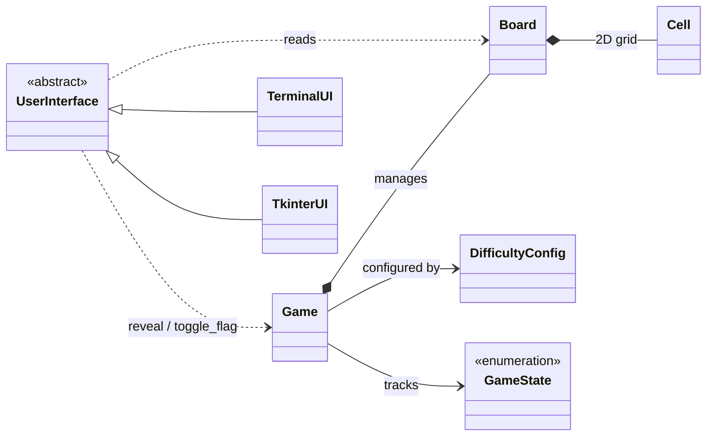

<a id="readme-top"></a>

<div align="center">

# 💣 PySweeper

**Minesweeper in your terminal, and a hands-on course for refactoring it into clean, object-oriented Python.**

[](https://github.com/hydrUsD/pysweeper/actions/workflows/tests.yml)


</div>

<!-- TODO: add a demo GIF here, e.g. recorded with https://github.com/charmbracelet/vhs -->

<details>
<summary><b>Table of contents</b></summary>

- [About](#about)
- [Features](#features)
- [Getting started](#getting-started)
- [Usage](#usage)
- [Project structure](#project-structure)
- [Architecture](#architecture)
- [The OOP course](#the-oop-course)
- [Running the checks](#running-the-checks)
- [Roadmap](#roadmap)
- [License](#license)

</details>

## About

PySweeper started as a single-file Minesweeper clone (`main.py`) built on `curses` and `numpy`.
It works, but game logic, state and drawing all live in one module.

This repository rebuilds that game as a proper package, **one class per file**, following a UML class diagram.
The rebuild is guided by a Jupyter notebook course: each lesson explains a Python OOP concept
(with side-by-side comparisons to Java), sets a task, offers tiered hints and verifies the result with automated checks.

> [!NOTE]
> `main.py` is the finished, playable reference. The `pysweeper/` package is the refactor and is still being written.

## Features

- 🎮 Three classic difficulties: Easy (9×9, 10 mines), Medium (16×16, 40), Hard (16×30, 99)
- 🛡️ Safe first click: mines are placed only after your first reveal
- 🌊 Flood-fill reveal of empty areas
- 🎯 Chording: reveal a satisfied number to open all its unflagged neighbours
- ⏱️ Timer and remaining-mines counter
- ⌨️ Arrow keys or WASD, coloured numbers, in-game difficulty menu

## Getting started

### Prerequisites

- [Python 3.12](https://www.python.org/) (pinned in `.python-version`)
- [uv](https://docs.astral.sh/uv/) for dependencies and virtual environment
- A terminal with `curses` support (macOS and Linux work out of the box; on Windows install `windows-curses`)

### Installation

```bash
git clone https://github.com/hydrUsD/pysweeper.git
cd pysweeper
uv sync
```

`uv sync` creates `.venv/` and installs `numpy` plus the dev tools (`pytest`, `ipykernel`, `nbstripout`) from `uv.lock`.

If you plan to commit changes to the notebook, enable the output filter once per clone:

```bash
uv run nbstripout --install --attributes .gitattributes
```

It strips cell outputs from `*.ipynb` files on `git add`, so outputs and local paths never land in the repo. Your working copy keeps them.

<p align="right">(<a href="#readme-top">back to top</a>)</p>

## Usage

```bash
uv run main.py
```

| Key | Action |
|---|---|
| Arrow keys / `W` `A` `S` `D` | Move the cursor |
| `Space` / `Enter` | Reveal a cell (or chord on a satisfied number) |
| `F` | Toggle flag |
| `R` | Restart |
| `M` | Difficulty menu |
| `Q` | Quit |

## Project structure

```
pysweeper/
├── main.py                       # original single-file game (reference)
├── pysweeper-class-diagram.mmd   # target architecture (Mermaid)
├── pysweeper/                    # the OOP refactor, one class per file
│   ├── game_state.py             # GameState (Enum)
│   ├── difficulty_config.py      # DifficultyConfig + presets
│   ├── cell.py                   # Cell
│   ├── board.py                  # Board
│   ├── game.py                   # Game (controller)
│   └── ui/
│       ├── user_interface.py     # UserInterface (ABC)
│       └── terminal_ui.py        # TerminalUI (curses)
├── course/
│   ├── oop-kurs.ipynb            # the course notebook (German)
│   ├── _check.py, _hints.py      # check runner and tiered hints
│   └── tests/                    # pytest checks, one file per lesson
├── .gitattributes                # routes notebooks through nbstripout
└── LICENSE
```

## Architecture

The full diagram lives in [`pysweeper-class-diagram.mmd`](pysweeper-class-diagram.mmd) and serves as the contract for the refactor.
Here is the short version:



Key design decisions:

- **The UI depends on the game, never the other way round.** `Game` holds no reference to any UI, so a terminal or Tkinter front end can drive the same logic.
- **Coordinates are `(x, y)`**, with x as the column and `size = (width, height)`.
- **The grid is `List[List[Cell]]`**. The refactor drops `numpy` in favour of plain objects.

<p align="right">(<a href="#readme-top">back to top</a>)</p>

## The OOP course

Open `course/oop-kurs.ipynb` in PyCharm, VS Code or Jupyter and select the project's `.venv` kernel.
The course is written in **German** and targets developers who know OOP from Java but are new to it in Python.

| Lesson | Topic |
|---|---|
| L0 | Reading the class diagram, packages and modules |
| L1 | `GameState` and `DifficultyConfig`: `Enum` and `@dataclass(frozen=True)` |
| L2 | `Cell` |
| L3 | `Board`: building the grid |
| L4 | `Board`: mines, neighbours, flood-fill reveal |
| L4+ | Chording and board queries |
| L5 | `Game` as controller |
| L5+ | Timer and mine counter |
| L6 | `UserInterface` (abstract base class) and `TerminalUI` with `curses` |
| L7 | Bonus: `TkinterUI` |

Each lesson follows the same loop: 🎯 learning goal → 📖 theory → 🛠 task → 💡 hints → ✅ check.

## Running the checks

The tests check the package against the class diagram, lesson by lesson. Run a single lesson:

```bash
uv run pytest course/tests/test_l1.py
```

or call `check("l1")` from inside the notebook. Running the whole suite (`uv run pytest`) only passes once every lesson is done.

GitHub Actions runs the checks on every push and on pull requests to `main`, but only for finished lessons.
They're listed in `LESSONS` in [`.github/workflows/tests.yml`](.github/workflows/tests.yml). Add a lesson there when you complete it.

## Roadmap

- [x] Original game (`main.py`)
- [x] Course notebook and lesson checks
- [x] Package structure (L0)
- [ ] Core classes (L1–L5)
- [ ] `UserInterface` and `TerminalUI` (L6)
- [ ] Bonus: `TkinterUI` front end (L7)

<p align="right">(<a href="#readme-top">back to top</a>)</p>

## License

Distributed under the MIT License. See [`LICENSE`](LICENSE) for details.
